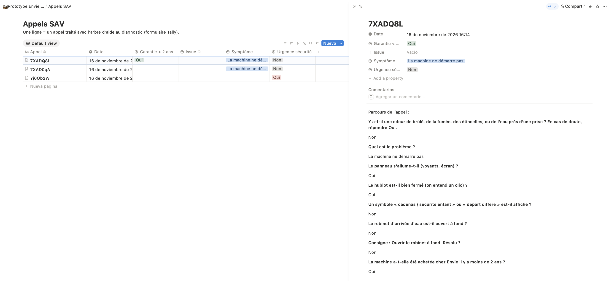
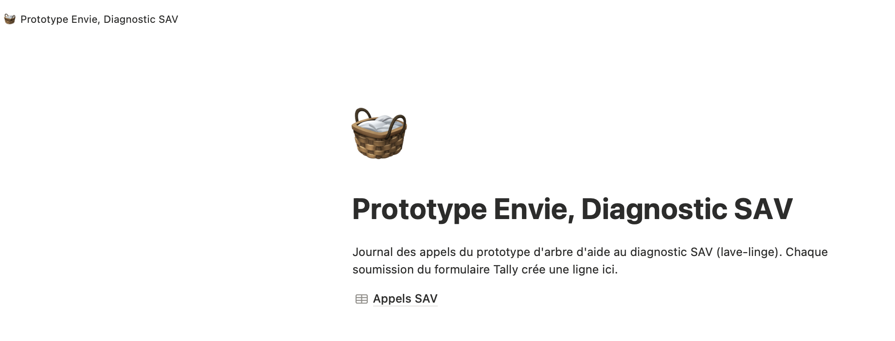

# Arbre d'aide au diagnostic SAV — Lave-linge

Prototype réalisé en 5 jours pour la candidature **Product Builder** chez Envie Le Labo — Fédération Envie.

**▶ Tester le formulaire : https://tally.so/r/laePaX**

---

## Problème

Un·e opérateur·rice en insertion reçoit l'appel d'un·e client·e dont le lave-linge acheté chez Envie « ne marche plus ». Sans expertise technique, il ou elle doit décider vite :

- est-ce dangereux ?
- est-ce une fausse panne qu'on peut régler au téléphone ?
- faut-il une intervention sous garantie, ou un devis ?

Et comme les parcours d'insertion durent au plus deux ans, le savoir de l'équipe part avec chaque personne qui s'en va.

> **Hypothèse à valider avec vos équipes :** le SAV commence par un appel client.

## Solution

Un arbre de décision, une question par écran, que l'opérateur·rice suit pendant l'appel :

1. **Toujours en premier : la sécurité.** Odeur de brûlé, fumée ou eau près d'une prise → consignes immédiates et escalade.
2. **6 symptômes**, formulés comme les client·es les décrivent.
3. **Des vérifications simples d'abord** (robinet, hublot, tuyau), puis les plus longues (filtre de vidange).
4. **5 issues possibles** :

| Issue | Ce que fait l'opérateur·rice |
|---|---|
| A — Urgence sécurité | Faire débrancher, couper l'eau, ne plus utiliser. Escalade prioritaire. |
| B — Résolu au téléphone | La consigne a fonctionné, ou le ou la client·e la teste et rappelle si besoin. |
| C — Prise en charge sous garantie | Ouvrir une demande d'intervention. |
| D — Réparation sur devis | Hors garantie : proposer un devis. |
| E — Escalade technicien·ne | Le ou la client·e ne sait pas répondre : on ne bloque jamais l'appel. |

Chaque appel est **enregistré automatiquement dans une base Notion** (date, symptôme, urgence, garantie, et le parcours complet question par question).

## Comment c'est construit

| Brique | Outil | Rôle |
|---|---|---|
| Contenu de l'arbre | [`arbre-lave-linge.md`](arbre-lave-linge.md) | Source de vérité, lisible et validable par les technicien·nes |
| Interface | Tally (no code) | 43 pages, ~80 règles de logique conditionnelle |
| Traçabilité | Intégration native Tally → Notion | Une ligne par appel |

### Traçabilité : chaque appel devient une ligne dans Notion

Le parcours complet de l'appel est enregistré dans la page de chaque ligne :

**Le contenu est séparé de l'outil.** L'arbre est décrit dans un fichier texte versionné : ajouter un appareil, c'est d'abord ajouter un fichier, que vos technicien·nes peuvent relire sans toucher à Tally.

## Choix de conception : où ne pas mettre l'IA

J'utilise l'IA au quotidien, mais je ne l'ai pas mise dans la décision. Dans un contexte de sécurité électrique, avec des utilisateur·rices qui débutent, un parcours **déterministe** est **traçable** (on sait pourquoi on arrive à une issue) et **validable** par vos technicien·nes. L'IA a sa place autour de l'arbre, pas à la place de l'arbre (voir prochaines étapes).

## Limites (assumées)

- **Contenu technique non validé** : rédigé à partir de sources publiques (fabricants, SAV de distributeurs, listées dans l'arbre). La branche « linge sale » est la moins documentée et doit être validée en priorité.
- **La garantie est demandée au client·e** : en production, elle viendrait du logiciel Réemploi (historique d'achat).
- **Un seul appareil** : le lave-linge.
- **L'issue finale n'est pas encore enregistrée dans Notion** : Tally ne transmet pas la page de fin atteinte (voir prochaines étapes).
- **Pas de création de ticket** ni de suivi de l'intervention.

## Prochaines étapes

1. **Valider le contenu** avec 1 ou 2 technicien·nes SAV, et l'hypothèse « appel client » avec les opérateur·rices.
2. **Enregistrer l'issue** (champ calculé Tally) pour mesurer l'impact : *part des appels résolus au téléphone = déplacements évités*.
3. **IA, en appui** : résumé de l'appel pour le ou la technicien·ne ; reformulation d'une description libre (« elle fait un bruit de train ») vers le bon symptôme, toujours validée par l'opérateur·rice.
4. **Intégration au logiciel Réemploi** : garantie et historique client automatiques, création de la demande d'intervention.
5. **Autres appareils** (réfrigérateur, cuisinière), sur le même modèle.

---

Gabriel Hono · [gabrielhono.com](https://www.gabrielhono.com) · [github.com/gab-hono](https://github.com/gab-hono)
